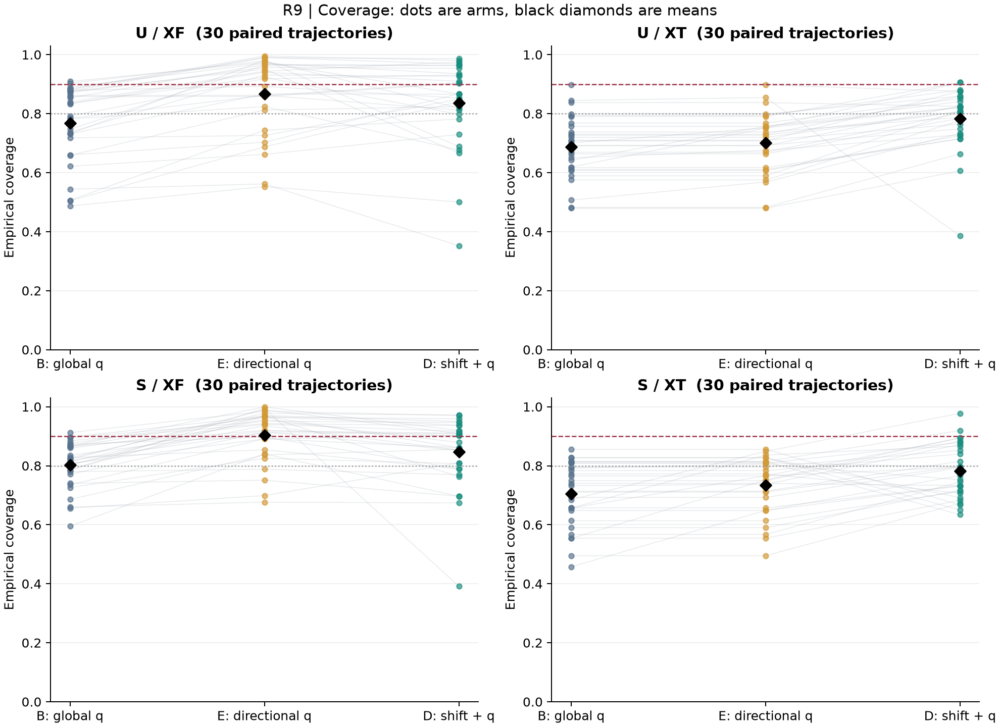
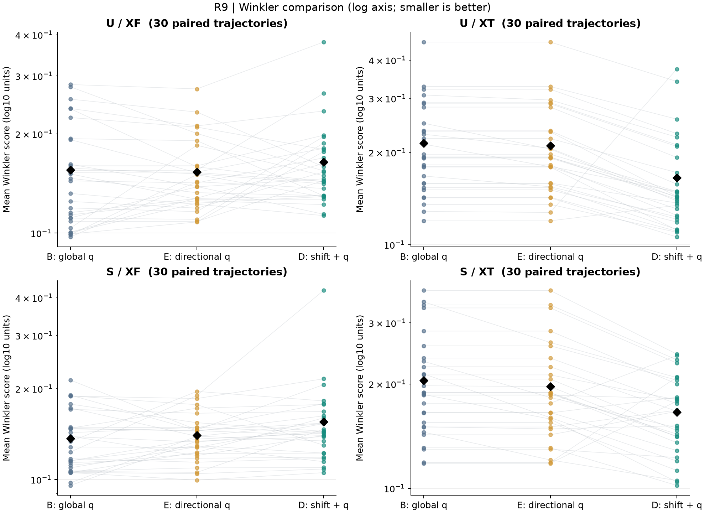
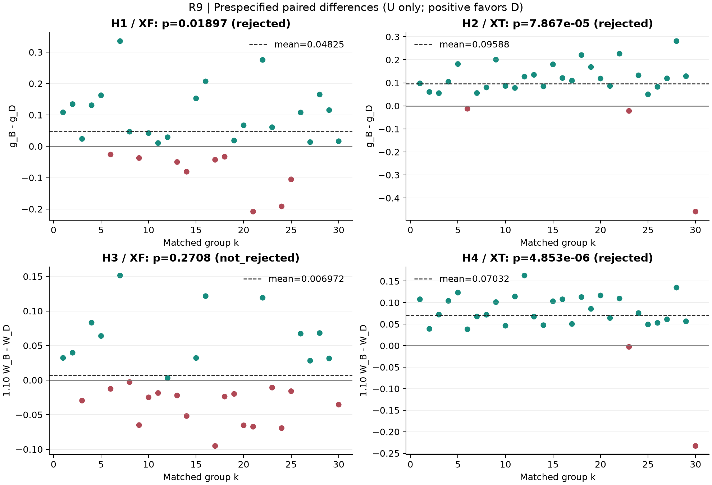
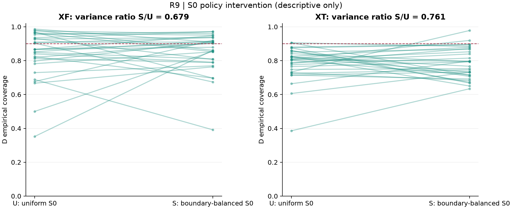

# 第九轮：方向性伪外推区间与中心偏差校正

作者：local_node researcher_a（R9c）；2026-10-08。预注册版本 R9f-local_node-researcher_a-1。

R9rev 说明：本次仅补齐封存数据的展示与解释，逐条处理[结果复审](../discussion/m10/reviewer_b_review_R9results.md)，见[主持人裁定](../discussion/m10/moderator_rulings.md)。预注册、封存结果、判据与已有数字均不变。`report_manifest.json` 与 `DELIVERED` 保留首次报告的历史哈希；本修订文稿以本次 Git 提交追溯，不重写历史封存，也不重跑首次报告生成脚本。

## 结论先行

**XF、XT 均未达到预注册 SUCCESS；不宣称整体外推成功。**

| 区域 | A | WIDTH | J | 覆盖检验 | Winkler 检验 | SUCCESS | 结论 |
| --- | --- | --- | --- | --- | --- | --- | --- |
| XF | 失败 | 失败 | 失败 | rejected | not_rejected | 失败 | 未达到完整经验覆盖标准；失败项：V80、HONEST90、MEAN90、FLOOR80 |
| XT | 失败 | 通过 | 失败 | rejected | rejected | 失败 | 未达到完整经验覆盖标准；失败项：V80、HONEST90、MEAN90、FLOOR80 |

流程有效：60/60 条轨迹、180/180 个区间臂、540 次正式拟合均完整，360/360 批采集逐点重放通过。独立复算核对了全部 720 个“区间臂×区域”指标、δ/q、诊断、精确 p 整数分子、门控与结论。合成冒烟使用额外一对 U/S 轨迹；不计入正式 K，也未读取真实留出标签。

以上检验支持均条件于固定 N87 数据及族划分上的配对差符号对称；对复合均值原假设还需对称位置平移模型。这些假设未经保证，截断欠缺和移位 Winkler 差可能偏斜。精确计算不验证推断前提；A/J 是经验标准，不是总体 90% 覆盖保证。完整 D 同时改变中心和尺度，不能据 D/B 拒绝归因于中心校正，也不能排除仅加宽解释。

## H1–H4：精确检验与区域序列

| 假设 | 区域/差值 | 整数分子 / 2^30 | 名义单侧 p | 正式状态 | 平均差 | 中位差 | IQR | 正/零/负 |
| --- | --- | --- | --- | --- | --- | --- | --- | --- |
| H1 | XF：g_B−g_D | 20367032 / 1073741824 | 0.018968277 | rejected | 0.048249083 | 0.035515762 | 0.15848722 | 21/0/9 |
| H2 | XT：g_B−g_D | 84466 / 1073741824 | 7.8665093e-05 | rejected | 0.095881766 | 0.10710006 | 0.055961654 | 27/0/3 |
| H3 | XF：1.10W_B−W_D | 290741893 / 1073741824 | 0.27077449 | not_rejected | 0.0069722391 | -0.011703525 | 0.066179367 | 13/0/17 |
| H4 | XT：1.10W_B−W_D | 5211 / 1073741824 | 4.8531219e-06 | rejected | 0.070321441 | 0.072087911 | 0.056703697 | 28/0/2 |

XF 固定序列 H1→H3，XT 固定序列 H2→H4；各 α=0.025，严格 p<0.025 才拒绝。一族首项不拒绝仅令本族次项未检验；无 α 回收。所有 30 对均保留，无门控筛选、删对或十进制预舍入。以封存 binary64 差值和 ε=1e−12 的精确二进制有理值计算两半各 2^15 的整数 MITM；独立复算改写为翻转子集和计数。

| k | H1 d | H2 d | H3 d | H4 d |
| --- | --- | --- | --- | --- |
| 1 | 0.10835665 | 0.097423607 | 0.032127325 | 0.10779256 |
| 2 | 0.13448983 | 0.060275614 | 0.039611584 | 0.039111178 |
| 3 | 0.023670957 | 0.055122828 | -0.029602626 | 0.072245754 |
| 4 | 0.13094572 | 0.10485321 | 0.083050303 | 0.10413092 |
| 5 | 0.16263757 | 0.18166567 | 0.063879396 | 0.12327446 |
| 6 | -0.026114531 | -0.012582385 | -0.012625739 | 0.037970317 |
| 7 | 0.33538519 | 0.055602157 | 0.15132575 | 0.067863471 |
| 8 | 0.046614438 | 0.079808268 | -0.0028307784 | 0.071930067 |
| 9 | -0.037306473 | 0.20059916 | -0.065027349 | 0.10120986 |
| 10 | 0.042137661 | 0.086279209 | -0.024947512 | 0.046366181 |
| 11 | 0.010427159 | 0.077651288 | -0.018649249 | 0.11416769 |
| 12 | 0.028893863 | 0.1267825 | 0.002869599 | 0.1630759 |
| 13 | -0.049990673 | 0.13469143 | -0.022148689 | 0.067446854 |
| 14 | -0.080936392 | 0.084481726 | -0.051916615 | 0.047623578 |
| 15 | 0.15275135 | 0.18010785 | 0.03201872 | 0.10319132 |
| 16 | 0.20705092 | 0.12079089 | 0.12151397 | 0.10778982 |
| 17 | -0.042902444 | 0.10934691 | -0.095195197 | 0.0504384 |
| 18 | -0.033184107 | 0.22049131 | -0.023793484 | 0.11297225 |
| 19 | 0.018261518 | 0.16860395 | -0.019956259 | 0.085555633 |
| 20 | 0.066946465 | 0.11863391 | -0.065396397 | 0.11666847 |
| 21 | -0.20798359 | 0.086279209 | -0.067362038 | 0.06437269 |
| 22 | 0.2755083 | 0.22648292 | 0.11915406 | 0.10964405 |
| 23 | 0.060790897 | -0.022049131 | -0.010781312 | -0.0027809757 |
| 24 | -0.19156874 | 0.13253445 | -0.069419565 | 0.075701492 |
| 25 | -0.10539079 | 0.050089874 | -0.01602723 | 0.049153361 |
| 26 | 0.10781571 | 0.082444578 | 0.067206445 | 0.053037531 |
| 27 | 0.01343033 | 0.11911324 | 0.028094664 | 0.061096445 |
| 28 | 0.16508114 | 0.28106651 | 0.068064662 | 0.13491913 |
| 29 | 0.11544488 | 0.12881965 | 0.031386477 | 0.056642449 |
| 30 | 0.016209662 | -0.45895746 | -0.035455736 | -0.23296762 |

## 经验门控：全部处理与方法

| 处理 | 方法 | 区 | C1 | V80 | HONEST90 | FLOOR80 | MEAN90 总计/门槛 | WIDTH 逐对 | 均宽比 | A | WIDTH | J |
| --- | --- | --- | --- | --- | --- | --- | --- | --- | --- | --- | --- | --- |
| U | B | XF | 30 | 15 | 2 | 15 | 123596/144747 | 30 | 1 | 失败 | 通过 | 失败 |
| U | B | XT | 30 | 3 | 0 | 3 | 172045/225315 | 30 | 1 | 失败 | 通过 | 失败 |
| U | E | XF | 30 | 18 | 16 | 23 | 139333/144747 | 26 | 1.4504765 | 失败 | 失败 | 失败 |
| U | E | XT | 30 | 3 | 0 | 3 | 175336/225315 | 30 | 1.0273548 | 失败 | 通过 | 失败 |
| U | D | XF | 30 | 19 | 13 | 22 | 134518/144747 | 27 | 1.4449792 | 失败 | 失败 | 失败 |
| U | D | XT | 30 | 17 | 2 | 17 | 196146/225315 | 30 | 1.0178848 | 失败 | 通过 | 失败 |
| S | B | XF | 30 | 19 | 1 | 19 | 129073/144747 | 30 | 1 | 失败 | 通过 | 失败 |
| S | B | XT | 30 | 7 | 0 | 7 | 176419/225315 | 30 | 1 | 失败 | 通过 | 失败 |
| S | E | XF | 30 | 20 | 19 | 26 | 145416/144747 | 26 | 1.5640597 | 失败 | 失败 | 失败 |
| S | E | XT | 30 | 10 | 0 | 10 | 183592/225315 | 30 | 1.0554272 | 失败 | 通过 | 失败 |
| S | D | XF | 30 | 19 | 14 | 22 | 136135/144747 | 27 | 1.4466815 | 失败 | 失败 | 失败 |
| S | D | XT | 30 | 11 | 2 | 11 | 195886/225315 | 30 | 1.0384055 | 失败 | 通过 | 失败 |

通过数的分母均为 30。V80 和 HONEST90 各需 ≥26；FLOOR80 和 WIDTH 逐对各需 30/30。C1 要求 G9≥3685/4606；XF 的 80%/90% 下限为 4289/4825，XT 为 6676/7511。V80 另要求本区均宽≤3×G9 均宽。WIDTH 同时要求均宽≤1.50×配对 B，且每对≤2.00×B。MEAN90 使用整数总覆盖数，不合并 XF/XT。

U-D XF 覆盖失败项：V80、HONEST90、MEAN90、FLOOR80；宽度单对否决 k=[15, 20, 23]（w_D/w_B：k=15：2.0870473 倍；k=20：2.1825876 倍；k=23：2.1995536 倍，均超过逐对上限）；均宽上限：通过。B/D 非零 g 臂数为 28/17，平均 g 为 0.1319045/0.083655413。

U-D XT 覆盖失败项：V80、HONEST90、MEAN90、FLOOR80；宽度单对否决 k=[]；均宽上限：通过。B/D 非零 g 臂数为 30/28，平均 g 为 0.21278211/0.11690034。

## 覆盖、宽度与 Winkler 关键数字

| 处理 | 方法 | 区域 | 平均覆盖 | 覆盖最小–最大 | 平均 g | 平均宽度 | 平均 Winkler | W 最小–最大 | MAE | 中心偏差 | 中位相对误差的臂均值 |
| --- | --- | --- | --- | --- | --- | --- | --- | --- | --- | --- | --- |
| U | B | G9 | 0.9077001 | 0.87082067–0.93204516 | 0.003414387 | 0.0429594 | 0.057705856 | 0.047458347–0.086545166 | 0.0099466107 | 0.00025242866 | 0.018175937 |
| U | B | XF | 0.76848847 | 0.48684947–0.90897221 | 0.1319045 | 0.071597191 | 0.1555693 | 0.097294012–0.28243291 | 0.024902337 | -0.015275478 | 0.045069882 |
| U | B | XFT | 0.38290455 | 0.065436242–0.90324385 | 0.51720358 | 0.10292552 | 0.5322718 | 0.13265619–1.4675495 | 0.064739968 | -0.064340422 | 0.13296728 |
| U | B | XT | 0.68721789 | 0.47932894–0.89754344 | 0.21278211 | 0.070963244 | 0.21430927 | 0.11963526–0.45796171 | 0.029496391 | -0.023446685 | 0.054155586 |
| U | E | G9 | 0.9077001 | 0.87082067–0.93204516 | 0.003414387 | 0.0429594 | 0.057705856 | 0.047458347–0.086545166 | 0.0099466107 | 0.00025242866 | 0.018175937 |
| U | E | XF | 0.86633713 | 0.55269539–0.99533669 | 0.066185413 | 0.10385005 | 0.15315169 | 0.10807968–0.27395502 | 0.024902337 | -0.015275478 | 0.045069882 |
| U | E | XFT | 0.58827368 | 0.084451902–1 | 0.32551827 | 0.1496274 | 0.41866486 | 0.18517225–1.4496835 | 0.064739968 | -0.064340422 | 0.13296728 |
| U | E | XT | 0.70036349 | 0.47932894–0.89754344 | 0.19963651 | 0.072904428 | 0.21013427 | 0.11963526–0.45796171 | 0.029496391 | -0.023446685 | 0.054155586 |
| U | D | G9 | 0.9077001 | 0.87082067–0.93204516 | 0.003414387 | 0.0429594 | 0.057705856 | 0.047458347–0.086545166 | 0.0099466107 | 0.00025242866 | 0.018175937 |
| U | D | XF | 0.83639868 | 0.35235963–0.98638314 | 0.083655413 | 0.10345645 | 0.16415399 | 0.11300089–0.38009577 | 0.02673732 | 0.00034742201 | 0.051413829 |
| U | D | XFT | 0.79011931 | 0.32438479–1 | 0.14483221 | 0.14959143 | 0.26359529 | 0.12248219–0.82172464 | 0.042929128 | -0.031687588 | 0.088100166 |
| U | D | XT | 0.78348712 | 0.38573996–0.90581186 | 0.11690034 | 0.07223241 | 0.16541875 | 0.10596007–0.37416993 | 0.02388231 | -0.0064167511 | 0.042265002 |
| S | B | G9 | 0.90662903 | 0.84303083–0.93812419 | 0.0042929512 | 0.045953224 | 0.062010746 | 0.049368399–0.089141666 | 0.010639231 | 0.00028214433 | 0.019321483 |
| S | B | XF | 0.80254306 | 0.59485171–0.91232979 | 0.097867935 | 0.06901368 | 0.13692134 | 0.095631503–0.21359757 | 0.021410848 | -0.0074533231 | 0.037038165 |
| S | B | XFT | 0.47583893 | 0.06935123–0.83333333 | 0.42416107 | 0.097362051 | 0.42382016 | 0.1449002–1.0021582 | 0.053805634 | -0.052899871 | 0.10793722 |
| S | B | XT | 0.70468943 | 0.45739964–0.85584182 | 0.19531057 | 0.073058279 | 0.20448191 | 0.11804334–0.37190995 | 0.028702568 | -0.020512304 | 0.053504132 |
| S | E | G9 | 0.90662903 | 0.84303083–0.93812419 | 0.0042929512 | 0.045953224 | 0.062010746 | 0.049368399–0.089141666 | 0.010639231 | 0.00028214433 | 0.019321483 |
| S | E | XF | 0.90415967 | 0.67655288–0.99906734 | 0.031641485 | 0.10794151 | 0.14011987 | 0.099538712–0.19589033 | 0.021410848 | -0.0074533231 | 0.037038165 |
| S | E | XFT | 0.73130127 | 0.13758389–0.97091723 | 0.17934004 | 0.15498762 | 0.29673386 | 0.14777543–0.87720797 | 0.053805634 | -0.052899871 | 0.10793722 |
| S | E | XT | 0.73334132 | 0.49526663–0.85584182 | 0.16665868 | 0.077107696 | 0.19646333 | 0.11804334–0.37190995 | 0.028702568 | -0.020512304 | 0.053504132 |
| S | D | G9 | 0.90662903 | 0.84303083–0.93812419 | 0.0042929512 | 0.045953224 | 0.062010746 | 0.049368399–0.089141666 | 0.010639231 | 0.00028214433 | 0.019321483 |
| S | D | XF | 0.84645278 | 0.3913449–0.97183361 | 0.068310639 | 0.099840812 | 0.15524407 | 0.10542188–0.42287432 | 0.026736358 | 0.0042338677 | 0.052445795 |
| S | D | XFT | 0.85969426 | 0.47259508–1 | 0.077475764 | 0.14304208 | 0.20545835 | 0.10730741–0.42810738 | 0.03546617 | -0.022402535 | 0.070769204 |
| S | D | XT | 0.78244857 | 0.63403235–0.97795087 | 0.12079888 | 0.075864122 | 0.16584621 | 0.10190611–0.2437207 | 0.024716399 | -0.0017021585 | 0.04509542 |

区间在 log10 损耗尺度上对称，端点闭合；宽度、Winkler、MAE 和偏差均为 log10 单位。g 在每臂先截断再平均；区域内点等权、组间等权。XFT 使用冻结的 δ_F+δ_T 和 max(q_F,q_T) 规则，只报告，无门控或正式检验。所有指标的逐臂值及最小/最大值保留在 metrics.json。

## D/E 消融与两种相同宽度诊断（只报告）

为控制正文篇幅，六项差值的逐组原始向量已完整归档于 [metrics.json](../../lab/cases/magnet9/first/metrics.json) 的 `ablation[处理][区域][差值名].values`；处理为 U/S，区域为 XF/XT，差值名与下表一致，每个向量按 k 升序。正文呈现其分布特征，显示精度沿用原报告，完整精度以归档为准。

| 处理 | 区 | D/E 差值 | 均值 | 中位数 | 最小 | 最大 | 正/零/负 |
| --- | --- | --- | --- | --- | --- | --- | --- |
| U | XF | MAE_E-MAE_D | -0.0018349826 | 0.00019504741 | -0.015914981 | 0.008791845 | 15/0/15 |
| U | XF | W_E-W_D | -0.011002302 | -0.0012456801 | -0.11037054 | 0.074061418 | 14/0/16 |
| U | XF | bias_D-bias_E | 0.0156229 | 0.012645026 | -0.012450546 | 0.074374286 | 25/0/5 |
| U | XF | c_D-c_E | -0.029938444 | -0.0038239134 | -0.29304234 | 0.16414848 | 10/0/20 |
| U | XF | g_E-g_D | -0.017469999 | 0 | -0.2331468 | 0.16414848 | 8/11/11 |
| U | XF | w_D-w_E | -0.00039359533 | -0.0021687336 | -0.04165347 | 0.062115589 | 12/1/17 |
| U | XT | MAE_E-MAE_D | 0.0056140814 | 0.0068512063 | -0.026147984 | 0.01200608 | 28/0/2 |
| U | XT | W_E-W_D | 0.044715512 | 0.049374326 | -0.24675921 | 0.11727973 | 28/0/2 |
| U | XT | bias_D-bias_E | 0.017029934 | 0.016435993 | 0.011225674 | 0.044152528 | 30/0/0 |
| U | XT | c_D-c_E | 0.083123627 | 0.091851408 | -0.46890354 | 0.22049131 | 27/0/3 |
| U | XT | g_E-g_D | 0.082736169 | 0.091851408 | -0.46890354 | 0.22049131 | 27/0/3 |
| U | XT | w_D-w_E | -0.00067201763 | 0 | -0.016765259 | 0.013926096 | 4/17/9 |
| S | XF | MAE_E-MAE_D | -0.0053255102 | -0.0033730574 | -0.045126401 | 0.0077110029 | 6/0/24 |
| S | XF | W_E-W_D | -0.015124196 | -0.0047709015 | -0.23304323 | 0.047048758 | 8/0/22 |
| S | XF | bias_D-bias_E | 0.011687191 | 0.010076284 | -0.016818576 | 0.069087666 | 22/0/8 |
| S | XF | c_D-c_E | -0.057706895 | -0.021917553 | -0.60305913 | 0.11080022 | 3/0/27 |
| S | XF | g_E-g_D | -0.036669154 | 0 | -0.5086551 | 0.11080022 | 3/13/14 |
| S | XF | w_D-w_E | -0.0081007019 | -0.00085308447 | -0.069234191 | 0.024085829 | 10/0/20 |
| S | XT | MAE_E-MAE_D | 0.0039861689 | 0.0061133379 | -0.015181194 | 0.013053835 | 23/0/7 |
| S | XT | W_E-W_D | 0.030617126 | 0.041154921 | -0.090633203 | 0.12818925 | 23/0/7 |
| S | XT | bias_D-bias_E | 0.018810146 | 0.017880433 | 0.0060661398 | 0.031717823 | 30/0/0 |
| S | XT | c_D-c_E | 0.04910725 | 0.084781306 | -0.18837627 | 0.17819053 | 22/0/8 |
| S | XT | g_E-g_D | 0.045859796 | 0.079269023 | -0.18837627 | 0.17819053 | 22/0/8 |
| S | XT | w_D-w_E | -0.0012435743 | 0 | -0.017152844 | 0.0086302098 | 6/18/6 |

| 处理 | 区 | q 锚点 | 诊断差 | 均值 | 中位数 | 最小 | 最大 | 正/零/负 |
| --- | --- | --- | --- | --- | --- | --- | --- | --- |
| U | XF | qD | delta_W | -0.015564352 | -0.0030320503 | -0.1243639 | 0.045899651 | 10/0/20 |
| U | XF | qD | delta_c | -0.037511658 | -0.0098862153 | -0.27121806 | 0.076478269 | 9/0/21 |
| U | XF | qD | delta_g | -0.025316794 | 0 | -0.24286514 | 0.076478269 | 7/12/11 |
| U | XF | qE | delta_W | -0.016046809 | -0.0032041691 | -0.13617658 | 0.056158727 | 11/0/19 |
| U | XF | qE | delta_c | -0.040626749 | -0.013896661 | -0.25853386 | 0.079649319 | 10/0/20 |
| U | XF | qE | delta_g | -0.029505689 | 0 | -0.25853386 | 0.079649319 | 6/10/14 |
| U | XT | qD | delta_W | 0.046663522 | 0.050161214 | -0.2458042 | 0.11727973 | 28/0/2 |
| U | XT | qD | delta_c | 0.088995406 | 0.097363691 | -0.45895746 | 0.22648292 | 27/0/3 |
| U | XT | qD | delta_g | 0.088607949 | 0.097363691 | -0.45895746 | 0.22648292 | 27/0/3 |
| U | XT | qE | delta_W | 0.0458238 | 0.051329417 | -0.23718629 | 0.11727973 | 28/0/2 |
| U | XT | qE | delta_c | 0.087825045 | 0.10065908 | -0.45488316 | 0.22049131 | 27/0/3 |
| U | XT | qE | delta_g | 0.087631316 | 0.10065908 | -0.45488316 | 0.22049131 | 27/0/3 |
| S | XF | qD | delta_W | -0.02039517 | -0.0070670709 | -0.2935896 | 0.059428599 | 4/0/26 |
| S | XF | qD | delta_c | -0.049965802 | -0.020425294 | -0.57451968 | 0.15351614 | 4/0/26 |
| S | XF | qD | delta_g | -0.035891314 | 0 | -0.5086551 | 0.15351614 | 2/14/14 |
| S | XF | qE | delta_W | -0.011802972 | -0.0062561604 | -0.0824245 | 0.050808847 | 4/0/26 |
| S | XF | qE | delta_c | -0.035310576 | -0.018093639 | -0.21283343 | 0.13840701 | 3/0/27 |
| S | XF | qE | delta_g | -0.020502394 | -0.00065286327 | -0.21283343 | 0.13840701 | 2/13/15 |
| S | XT | qD | delta_W | 0.033414317 | 0.042950536 | -0.090633203 | 0.12818925 | 23/0/7 |
| S | XT | qD | delta_c | 0.056844418 | 0.091431995 | -0.18837627 | 0.21677651 | 22/0/8 |
| S | XT | qD | delta_g | 0.053596964 | 0.086129419 | -0.18837627 | 0.21677651 | 22/0/8 |
| S | XT | qE | delta_W | 0.031645336 | 0.041060208 | -0.090633203 | 0.12818925 | 24/0/6 |
| S | XT | qE | delta_c | 0.053608947 | 0.092929898 | -0.18837627 | 0.17819053 | 22/0/8 |
| S | XT | qE | delta_g | 0.049698422 | 0.080617136 | -0.18837627 | 0.17819053 | 22/0/8 |

U/XF/qD：均值改善指标 []；未改善指标 ['delta_W', 'delta_c', 'delta_g']。对这些未改善指标，未观察到相同宽度下的中心改善。

U/XF/qE：均值改善指标 []；未改善指标 ['delta_W', 'delta_c', 'delta_g']。对这些未改善指标，未观察到相同宽度下的中心改善。

U/XT/qD：均值改善指标 ['delta_W', 'delta_c', 'delta_g']；未改善指标 []。三项在该面板上平均改善。

U/XT/qE：均值改善指标 ['delta_W', 'delta_c', 'delta_g']；未改善指标 []。三项在该面板上平均改善。

S/XF/qD：均值改善指标 []；未改善指标 ['delta_W', 'delta_c', 'delta_g']。对这些未改善指标，未观察到相同宽度下的中心改善。

S/XF/qE：均值改善指标 []；未改善指标 ['delta_W', 'delta_c', 'delta_g']。对这些未改善指标，未观察到相同宽度下的中心改善。

S/XT/qD：均值改善指标 ['delta_W', 'delta_c', 'delta_g']；未改善指标 []。三项在该面板上平均改善。

S/XT/qE：均值改善指标 ['delta_W', 'delta_c', 'delta_g']；未改善指标 []。三项在该面板上平均改善。

δc=c(平移)−c(未平移)、δg=g(未平移)−g(平移)、δW=W(未平移)−W(平移)，正值支持改善。D/E 是中心与重新校准 q 的总改变；两锚点均报告，无择优，也不进入 SUCCESS。这些诊断不证明总体因果贡献。每项 30 个原始值均在 metrics.json。

## 校准与影子模型

| 轨迹 | q0 | δF | δT | qE_F | qD_F | qE_T | qD_T | qD_F/qE_F | qD_T/qE_T |
| --- | --- | --- | --- | --- | --- | --- | --- | --- | --- |
| S01 | 1.5950851 | 0.0255673 | 0.025775403 | 2.0366623 | 1.974744 | 1.5950851 | 1.5950851 | 0.96959811 | 1 |
| S02 | 1.4339475 | -0.0034721568 | 0.01860769 | 1.7165516 | 1.7093418 | 1.4339475 | 1.4339475 | 0.99579984 | 1 |
| S03 | 1.6991328 | 0.013204616 | 0.011031309 | 2.3176603 | 2.5160222 | 1.6991328 | 1.6991328 | 1.0855871 | 1 |
| S04 | 1.6872027 | 0.020611739 | 0.018312873 | 1.8132502 | 1.6872027 | 1.6872027 | 1.6872027 | 0.9304853 | 1 |
| S05 | 1.2184782 | 0.046545332 | 0.021604392 | 2.6347321 | 3.0928381 | 1.2184782 | 1.2184782 | 1.173872 | 1 |
| S06 | 1.2937937 | 0.011106752 | 0.02509854 | 1.8861242 | 1.7315194 | 1.2937937 | 1.2937937 | 0.9180304 | 1 |
| S07 | 1.4431185 | 0.022279684 | 0.024596527 | 1.5653797 | 1.6196415 | 1.4860648 | 1.4431185 | 1.0346637 | 0.97110067 |
| S08 | 1.4088454 | 0.016874289 | 0.017302805 | 2.1427491 | 2.2345888 | 1.4088454 | 1.4088454 | 1.0428607 | 1 |
| S09 | 1.5035957 | 0.0061359063 | 0.017150553 | 1.906963 | 1.8323701 | 1.5035957 | 1.5035957 | 0.9608839 | 1 |
| S10 | 1.3064149 | -0.001143782 | 0.014007443 | 1.3461995 | 1.3826436 | 1.7645895 | 1.816893 | 1.0270719 | 1.0296406 |
| S11 | 1.36373 | 0.012323605 | 0.016091265 | 2.5385712 | 2.5213222 | 1.36373 | 1.36373 | 0.99320521 | 1 |
| S12 | 1.3423865 | 0.0099033114 | 0.014789852 | 2.6399011 | 2.7260813 | 1.8477442 | 1.4960066 | 1.0326453 | 0.80963942 |
| S13 | 1.6523876 | 0.006581264 | 0.019651572 | 1.7707004 | 1.6641498 | 1.6523876 | 1.6523876 | 0.93982576 | 1 |
| S14 | 1.2781524 | 0.010127345 | 0.024431379 | 1.5661862 | 1.6423803 | 1.2781524 | 1.2781524 | 1.0486495 | 1 |
| S15 | 1.1127969 | 0.0067796717 | 0.012080776 | 2.2811186 | 2.0249364 | 1.1127969 | 1.1127969 | 0.88769449 | 1 |
| S16 | 1.4130645 | 0.019400907 | 0.017447992 | 2.703064 | 2.1909221 | 1.4268371 | 1.4130645 | 0.81053282 | 0.99034744 |
| S17 | 1.2592087 | 0.069087666 | 0.017142522 | 3.8866618 | 2.4559904 | 1.2592087 | 1.2592087 | 0.63190228 | 1 |
| S18 | 1.6585391 | 0.00067135972 | 0.017065451 | 2.3348198 | 2.3157611 | 1.6585391 | 1.6585391 | 0.99183717 | 1 |
| S19 | 1.2440606 | -0.016818576 | 0.022260212 | 1.9834595 | 2.167484 | 1.5179961 | 1.3120372 | 1.0927795 | 0.86432188 |
| S20 | 1.3477103 | 0.023405202 | 0.020339628 | 3.8961193 | 2.9582408 | 1.3477103 | 1.3477103 | 0.7592788 | 1 |
| S21 | 1.7086624 | 0.025450721 | 0.02191805 | 2.5709005 | 1.8229609 | 1.7086624 | 1.7086624 | 0.70907488 | 1 |
| S22 | 1.1879999 | -0.010323755 | 0.026672665 | 1.8101406 | 1.7993139 | 1.5307454 | 1.6809284 | 0.9940189 | 1.098111 |
| S23 | 1.3108909 | 0.010025224 | 0.031717823 | 2.4212682 | 2.0642579 | 1.3108909 | 1.3108909 | 0.85255237 | 1 |
| S24 | 1.2970694 | -0.0066784755 | 0.0096707781 | 2.0996428 | 2.1522992 | 1.2970694 | 1.2970694 | 1.0250788 | 1 |
| S25 | 1.4875537 | 0.020675075 | 0.014893795 | 2.9381419 | 2.5287935 | 1.4875537 | 1.4875537 | 0.86067778 | 1 |
| S26 | 1.5930771 | -0.0023753897 | 0.01547873 | 1.6263148 | 1.610963 | 2.4145061 | 2.0315668 | 0.99056041 | 0.84140056 |
| S27 | 1.0833388 | 0.0018019417 | 0.0060661398 | 1.6433937 | 1.6535132 | 1.0833388 | 1.0833388 | 1.0061577 | 1 |
| S28 | 1.5972514 | -0.0052174485 | 0.022853275 | 1.6474199 | 1.5972514 | 1.5972514 | 1.5972514 | 0.96954725 | 1 |
| S29 | 1.7028082 | -0.0053241163 | 0.012506992 | 2.1868691 | 2.1737643 | 1.7028082 | 1.7028082 | 0.99400749 | 1 |
| S30 | 1.9370586 | 0.023410513 | 0.027737944 | 3.1689361 | 2.1582182 | 1.9370586 | 1.9370586 | 0.68105449 | 1 |
| U01 | 1.5402639 | 0.0099477258 | 0.015865392 | 2.113382 | 2.0225407 | 1.5402639 | 1.5697351 | 0.95701614 | 1.0191339 |
| U02 | 1.580438 | -3.2022349e-05 | 0.015200807 | 2.1008778 | 2.1004403 | 1.580438 | 1.580438 | 0.99979174 | 1 |
| U03 | 1.2617922 | 0.0033093343 | 0.016400497 | 2.6281584 | 2.4756347 | 1.2617922 | 1.2617922 | 0.9419656 | 1 |
| U04 | 1.5499685 | 0.021534235 | 0.011285857 | 1.5855052 | 1.8183788 | 1.5499685 | 1.5499685 | 1.1468766 | 1 |
| U05 | 1.6764204 | 0.017062971 | 0.011225674 | 2.7630369 | 2.1297545 | 1.6764204 | 1.6764204 | 0.77080205 | 1 |
| U06 | 1.9745493 | 0.011163966 | 0.018194668 | 2.1482995 | 2.0599751 | 1.9745493 | 1.9745493 | 0.95888638 | 1 |
| U07 | 1.3989672 | 0.0062462338 | 0.015817615 | 1.8119039 | 2.0627679 | 1.3989672 | 1.3989672 | 1.1384533 | 1 |
| U08 | 1.4439454 | 0.0057508055 | 0.01759545 | 2.3946308 | 2.422326 | 1.4439454 | 1.4439454 | 1.0115655 | 1 |
| U09 | 1.6819328 | 0.038421991 | 0.013411415 | 2.055637 | 2.5480099 | 1.6819328 | 1.6819328 | 1.2395233 | 1 |
| U10 | 1.8945024 | 0.027861392 | 0.016471489 | 1.8950236 | 2.642406 | 1.8945024 | 1.8945024 | 1.3943922 | 1 |
| U11 | 1.3664879 | 0.01290481 | 0.016719955 | 2.370681 | 2.2270796 | 1.4594596 | 1.3664879 | 0.93942612 | 0.93629715 |
| U12 | 1.3904029 | -0.0080811636 | 0.013995469 | 2.2239158 | 2.1713734 | 1.3904029 | 1.3904029 | 0.97637393 | 1 |
| U13 | 2.0313647 | 0.012385243 | 0.012008839 | 2.0313647 | 2.0313647 | 2.0313647 | 2.0313647 | 1 | 1 |
| U14 | 1.6829087 | 0.028768402 | 0.017542826 | 2.7799907 | 2.3144053 | 1.6829087 | 1.6829087 | 0.83252266 | 1 |
| U15 | 1.1521017 | 0.0054325524 | 0.019163286 | 2.6112583 | 2.4044908 | 1.4555629 | 1.1521017 | 0.92081689 | 0.79151626 |
| U16 | 1.5275006 | 0.026774068 | 0.017578856 | 1.7289185 | 2.2935622 | 1.5275006 | 1.5275006 | 1.3265878 | 1 |
| U17 | 2.0539382 | 0.074374286 | 0.020663565 | 3.7155017 | 3.3820559 | 2.0539382 | 2.0539382 | 0.91025553 | 1 |
| U18 | 1.5535471 | 0.016227489 | 0.018312206 | 2.6002371 | 1.9009014 | 1.5535471 | 1.5535471 | 0.73104923 | 1 |
| U19 | 1.5500994 | 0.017501503 | 0.019338521 | 3.1965277 | 2.4995389 | 1.5500994 | 1.5500994 | 0.78195441 | 1 |
| U20 | 1.3819591 | 0.039489093 | 0.015684975 | 1.8074322 | 3.0162467 | 1.3819591 | 1.3819591 | 1.6688021 | 1 |
| U21 | 1.5712198 | 0.026759789 | 0.013629582 | 2.2417664 | 1.5980718 | 1.5712198 | 1.5712198 | 0.71286278 | 1 |
| U22 | 1.3319314 | 0.0055613741 | 0.012472635 | 1.8331645 | 1.750003 | 1.4645791 | 1.3319314 | 0.95463502 | 0.90942946 |
| U23 | 1.5845598 | 0.040094439 | 0.017638511 | 2.6627247 | 3.4853242 | 1.5845598 | 1.5845598 | 1.3089315 | 1 |
| U24 | 1.5839181 | -0.012450546 | 0.022153441 | 1.6328066 | 1.7458027 | 1.5839181 | 1.5839181 | 1.0692036 | 1 |
| U25 | 1.9908136 | -0.011067535 | 0.016943931 | 2.128789 | 2.2127093 | 1.9908136 | 1.9908136 | 1.0394216 | 1 |
| U26 | 1.8367966 | 0.0048401398 | 0.012771709 | 1.9597864 | 1.9882022 | 1.8367966 | 1.8367966 | 1.0144994 | 1 |
| U27 | 1.4283379 | -0.0018354219 | 0.011814992 | 1.5679247 | 1.5300954 | 1.5943599 | 1.4655171 | 0.97587302 | 0.91918836 |
| U28 | 1.1287785 | 0.0041988269 | 0.020587032 | 1.5394586 | 1.4507643 | 1.4923113 | 1.7317561 | 0.94238602 | 1.1604523 |
| U29 | 1.5046376 | 0.027296805 | 0.016256285 | 1.8175862 | 2.1854051 | 1.5046376 | 1.5046376 | 1.2023667 | 1 |
| U30 | 1.4673414 | 0.01824622 | 0.044152528 | 3.616566 | 2.795062 | 1.5014444 | 1.4673414 | 0.77284971 | 0.97728651 |

| 处理 | 方向 | 参数 | 均值 | 中位数 | 最小 | 最大 |
| --- | --- | --- | --- | --- | --- | --- |
| U | F | delta | 0.0156229 | 0.012645026 | -0.012450546 | 0.074374286 |
| U | F | qD-qE | -0.0099387596 | -0.045185836 | -0.82150401 | 1.2088145 |
| U | T | delta | 0.017029934 | 0.016435993 | 0.011225674 | 0.044152528 |
| U | T | qD-qE | -0.014103684 | 0 | -0.30346121 | 0.23944478 |
| S | F | delta | 0.011687191 | 0.010076284 | -0.016818576 | 0.069087666 |
| S | F | qD-qE | -0.16901284 | -0.018153901 | -1.4306713 | 0.45810607 |
| S | T | delta | 0.018810146 | 0.017880433 | 0.0060661398 | 0.031717823 |
| S | T | qD-qE | -0.02649561 | 0 | -0.38293932 | 0.15018297 |

| 模型 | 实际均值列 | 训练温度层 | 秩范围 | 条件数最小–最大 | 秩亏模型数 |
| --- | --- | --- | --- | --- | --- |
| 主模型全部420次 | 1, log10_f, log10_Bpk, T_C, T_C^2, shape | [(25, 50, 70)] | 6–6 | 71369.872–101395.27 | 0 |
| M_F | 1, log10_f, log10_Bpk, T_C, T_C^2, shape | [(25, 50, 70)] | 6–6 | 83370.434–95838.346 | 0 |
| M_T | 1, log10_f, log10_Bpk, T_C, shape | [(25, 50)] | 5–5 | 722.12696–834.31386 | 0 |

| 处理 | 方向 | 训练核心点数范围 | 训练边缘点数范围 | 核心族数范围 | 边缘族数范围 | CAL边缘点/族 |
| --- | --- | --- | --- | --- | --- | --- |
| U | F | 160–176 | 44–60 | 80–97 | 13–22 | 885/6 |
| U | T | 126–142 | 78–94 | 77–88 | 53–65 | 821/20 |
| S | F | 141–147 | 73–79 | 68–82 | 20–26 | 885/6 |
| S | T | 128–139 | 81–92 | 74–87 | 52–66 | 821/20 |

M_T 仅用 25/50°C，按预注册删除 T_C²；M_F 保留六列。主模型所有检查点均保留六列。每个模型从头拟合自己的 OLS、scaler 和残差 GP，优化重启 2 次，σ 含 WhiteKernel。核心外的已查询训练点仅估 δ，CAL 仅估 q，不混用。优化器达到边界的警告保存在日志，未更改参数界或模型。实际逐模型秩、条件数、列与训练 ID 见各轨迹 result.json 及 model_*.json/shadow_*.json。

## S0 干预、覆盖方差与分解（只报告）

| 区 | v_U | v_S | S/U | 方差降幅 | Δg均值 | 预定支持判据结论 |
| --- | --- | --- | --- | --- | --- | --- |
| XF | 0.021067624 | 0.014313893 | 0.67942606 | 0.32057394 | 0.015344774 | 未满足该预定支持判据 |
| XT | 0.010624089 | 0.0080797708 | 0.76051422 | 0.23948578 | -0.003898542 | 未满足该预定支持判据 |

以下补充表直接摘录 `metrics.json` 的 `S0[区域][U/S/Delta_g]` 字段。Δg 为同号 k 的 D 方法欠覆盖差 g_U−g_S，正值表示 S 的欠覆盖较少；它不等于未截断的覆盖率差。显示精度沿用正文，逐组完整精度仍保存在 `Delta_g.values`，不增加检验或重采样。

| 区 | 量 | 均值 | 中位数 | 最小 | 最大 |
| --- | --- | --- | --- | --- | --- |
| XF | U：D 覆盖率 | 0.83639868 | 0.86634956 | 0.35235963 | 0.98638314 |
| XF | S：D 覆盖率 | 0.84645278 | 0.87026674 | 0.3913449 | 0.97183361 |
| XF | 配对欠覆盖差 g_U−g_S | 0.015344774 | 0 | -0.29677299 | 0.50886029 |
| XT | U：D 覆盖率 | 0.78348712 | 0.80641102 | 0.38573996 | 0.90581186 |
| XT | S：D 覆盖率 | 0.78244857 | 0.77998802 | 0.63403235 | 0.97795087 |
| XT | 配对欠覆盖差 g_U−g_S | -0.003898542 | 0.015518274 | -0.20802876 | 0.24829239 |

| k | XF：g_U−g_S | XT：g_U−g_S |
| --- | --- | --- |
| 1 | -0.092874464 | -0.022648292 |
| 2 | 0.034116769 | -0.15206711 |
| 3 | 0 | 0.028040743 |
| 4 | -0.039171796 | 0.017615339 |
| 5 | 0 | 0.13361294 |
| 6 | 0.047360567 | -0.17447573 |
| 7 | -0.049617609 | 0.004074296 |
| 8 | -0.046614438 | 0.045296585 |
| 9 | 0.10220108 | 0.039185141 |
| 10 | -0.22605857 | 0.015218694 |
| 11 | 0 | -0.04505692 |
| 12 | 0 | 0.12522469 |
| 13 | -0.023316545 | 0.05308568 |
| 14 | 0.080936392 | -0.046494907 |
| 15 | 0 | -0.055122828 |
| 16 | 0.011938071 | 0.087717196 |
| 17 | -0.29677299 | -0.1869982 |
| 18 | 0.033184107 | 0.090173757 |
| 19 | -0.20330162 | 0.016896345 |
| 20 | 0 | 0.019892151 |
| 21 | 0.096623764 | -0.0094667466 |
| 22 | 0.070136169 | 0.16674655 |
| 23 | 0 | -0.20802876 |
| 24 | 0.50886029 | -0.085080887 |
| 25 | 0.22307405 | 0.051767525 |
| 26 | 0.040104458 | 0.015817855 |
| 27 | 0.35534415 | -0.087118035 |
| 28 | -0.12684201 | -0.016476932 |
| 29 | 0 | -0.18657879 |
| 30 | -0.038966611 | 0.24829239 |

| 区 | SS_total | SS_group | SS_method | SS_interaction | 组占比 | 方法占比 | 交互占比 | 共享组分量过半 |
| --- | --- | --- | --- | --- | --- | --- | --- | --- |
| XF | 1.7284655 | 1.2629182 | 0.15082468 | 0.31472257 | 0.73065864 | 0.087259297 | 0.18208207 | 通过 |
| XT | 1.080163 | 0.62159548 | 0.16350107 | 0.29506641 | 0.57546454 | 0.15136704 | 0.27316842 | 通过 |

双方向结论：未满足该预定支持判据；不声称 S0 不影响覆盖离散。支持规则为 v_U>0、v_S≤0.50v_U 且 mean(g_U−g_S)≥0。v_U=0 时比值与支持不可评，不加 ε。U 的 30×3 矩阵无格内重复，交互与残余不可分。干预是“S0政策+后续采集”的总影响，不能隔离纯 S0，也不能追溯证明第八轮离散成因。

## Winkler 非劣敏感性（U；只报告）

| 区 | mean(W_D)/mean(W_B) | 逐一删对均值最小 | 最大 | 非正个数 |
| --- | --- | --- | --- | --- |
| XF | 1.0551824 | 0.0019945319 | 0.010495254 | 0 |
| XT | 0.77186934 | 0.067123011 | 0.080779685 | 0 |

| k | XF W_D/W_B | XT W_D/W_B | XF去掉k的均差 | XT去掉k的均差 |
| --- | --- | --- | --- | --- |
| 1 | 0.85649078 | 0.72587389 | 0.0061048224 | 0.069029333 |
| 2 | 0.83794524 | 0.81100043 | 0.0058467445 | 0.071397657 |
| 3 | 1.4042595 | 0.77440383 | 0.0082334414 | 0.070255085 |
| 4 | 0.6707121 | 0.78253259 | 0.0043488576 | 0.069155597 |
| 5 | 0.70510955 | 0.71636201 | 0.0050099234 | 0.068495475 |
| 6 | 1.1825899 | 0.86098438 | 0.0076480315 | 0.071436997 |
| 7 | 0.5556763 | 0.7559818 | 0.0019945319 | 0.070406199 |
| 8 | 1.124531 | 0.72784962 | 0.0073102742 | 0.070265971 |
| 9 | 1.6455239 | 0.66962198 | 0.0094549836 | 0.069256323 |
| 10 | 1.3298898 | 0.77523997 | 0.0080729202 | 0.071147484 |
| 11 | 1.2858084 | 0.72892558 | 0.0078557387 | 0.068809502 |
| 12 | 1.0747275 | 0.74390931 | 0.0071137095 | 0.067123011 |
| 13 | 1.2383954 | 0.74802866 | 0.0079764091 | 0.070420565 |
| 14 | 1.6158467 | 0.78460997 | 0.0090028893 | 0.071104126 |
| 15 | 0.89658301 | 0.61501702 | 0.0061085674 | 0.069187997 |
| 16 | 0.62345499 | 0.72881639 | 0.0030225244 | 0.069029428 |
| 17 | 1.7147009 | 0.74525075 | 0.010495254 | 0.071007063 |
| 18 | 1.3139625 | 0.61577419 | 0.0080331261 | 0.068850724 |
| 19 | 1.301925 | 0.62250632 | 0.0079008081 | 0.069796124 |
| 20 | 1.688991 | 0.6848868 | 0.0094677094 | 0.068723268 |
| 21 | 1.7779141 | 0.76570607 | 0.0095354901 | 0.07052657 |
| 22 | 0.60042279 | 0.62173236 | 0.0031039004 | 0.068965489 |
| 23 | 1.1748665 | 1.1232455 | 0.0075844306 | 0.072842214 |
| 24 | 1.3457913 | 0.68434917 | 0.0096064393 | 0.070135922 |
| 25 | 1.2284967 | 0.82695829 | 0.0077653243 | 0.071051375 |
| 26 | 0.80024087 | 0.76479613 | 0.0048951976 | 0.070917438 |
| 27 | 0.98241583 | 0.73523959 | 0.0062438797 | 0.070639544 |
| 28 | 0.74577093 | 0.55807722 | 0.0048656039 | 0.068093935 |
| 29 | 0.88595387 | 0.73092075 | 0.0061303689 | 0.07079313 |
| 30 | 1.4422762 | 2.914874 | 0.0084352728 | 0.080779685 |

分母为零时记 null；原检验保留所有配对。上述 30 个删对描述量不产生新 p，不用于择对，不改变 K=30。未做 Bootstrap、替代检验或额外重采样；描述性敏感性不能验证符号对称或修复 FWER。

## 设计、采样与阶段封存

预注册提交 `cb912d916b76a055680794f1ac4e5b7e0e8765ca`；H=3415289233；GP seed=1267805585。设计种子为 2^96+H×2^16+r×256+k，PCG64 完整整数。R6/R7/R8 历史种子与本轮种子集合交集为空；这不表示样本 ID 互斥或独立新测量。

| 集合 | 点数 | 族数 |
| --- | --- | --- |
| CAL9 | 2458 | 20 |
| G9 | 4606 | 30 |
| S | 25122 | 220 |
| XF | 5361 | 69 |
| XFT | 1788 | 67 |
| XT | 8345 | 217 |
| pool | 18058 | 170 |

| P层 | 实际点数 | S0配额 |
| --- | --- | --- |
| core_25 | 5077 | 16 |
| core_50 | 5090 | 17 |
| core_70 | 5102 | 17 |
| edge_25 | 931 | 16 |
| edge_50 | 928 | 17 |
| edge_70 | 930 | 17 |

| 处理 | 阶段 | 计数 | fset计数 | 温度计数 | v八档计数 |
| --- | --- | --- | --- | --- | --- |
| U | S0 | 3000 | {'50': 121, '56': 175, '63': 138, '71': 201, '79': 240, '89': 146, '100': 220, '112': 184, '126': 216, '141': 212, '159': 138, '178': 269, '199': 257, '224': 139, '251': 160, '282': 184} | {'25': 957, '50': 1025, '70': 1018} | {'0': 27, '1': 179, '2': 566, '3': 648, '4': 617, '5': 515, '6': 333, '7': 115} |
| U | additions | 3600 | {'50': 591, '56': 548, '63': 22, '71': 100, '79': 122, '89': 65, '100': 223, '112': 42, '126': 210, '141': 193, '159': 215, '178': 162, '199': 93, '224': 17, '251': 143, '282': 854} | {'25': 1624, '50': 417, '70': 1559} | {'0': 503, '1': 480, '2': 615, '3': 307, '4': 425, '5': 663, '6': 158, '7': 449} |
| S | S0 | 3000 | {'50': 67, '56': 107, '63': 88, '71': 119, '79': 148, '89': 84, '100': 132, '112': 99, '126': 133, '141': 120, '159': 83, '178': 175, '199': 145, '224': 419, '251': 529, '282': 552} | {'25': 960, '50': 1020, '70': 1020} | {'0': 23, '1': 105, '2': 522, '3': 655, '4': 623, '5': 539, '6': 370, '7': 163} |
| S | additions | 3600 | {'50': 667, '56': 590, '63': 24, '71': 103, '79': 118, '89': 90, '100': 269, '112': 74, '126': 243, '141': 209, '159': 192, '178': 126, '199': 106, '224': 25, '251': 135, '282': 629} | {'25': 1661, '50': 330, '70': 1609} | {'0': 486, '1': 522, '2': 608, '3': 335, '4': 380, '5': 673, '6': 143, '7': 453} |

上述采样计数对 30 条轨迹求和，包含跨轨迹重复 ID；每条轨迹内无放回。v=log10(4fBpk) 八个等宽档在整个 P 上定义，边界为 [3.555472461398943, 3.7662271812507893, 3.976981901102635, 4.187736620954481, 4.398491340806327, 4.609246060658173, 4.82000078051002, 5.030755500361865, 5.241510220213711]。validity_pass_counts 为门控通过臂数，与 sampling_counts 分开。

| 范围 | 变量 | 实际最小 | 实际最大 |
| --- | --- | --- | --- |
| P | T_C | 25 | 70 |
| P | amplitude_T | 0.010543025 | 0.28011999 |
| P | frequency_Hz | 49950 | 282500 |
| P | fset | 50 | 282 |
| P | v | 3.5554725 | 5.2415102 |
| U全部最终训练并集 | T_C | 25 | 70 |
| U全部最终训练并集 | amplitude_T | 0.010543025 | 0.28011999 |
| U全部最终训练并集 | frequency_Hz | 49950 | 282500 |
| U全部最终训练并集 | fset | 50 | 282 |
| U全部最终训练并集 | v | 3.5554725 | 5.2409431 |
| S全部最终训练并集 | T_C | 25 | 70 |
| S全部最终训练并集 | amplitude_T | 0.010543025 | 0.28011999 |
| S全部最终训练并集 | frequency_Hz | 49950 | 282500 |
| S全部最终训练并集 | fset | 50 | 282 |
| S全部最终训练并集 | v | 3.5554725 | 5.2415102 |

每条轨迹 100 个 S0+6×20 个新增标签，共 220 点；B/E/D 共用本轨迹全部主模型与采集。训练、CAL 和评估读标签权限按处理/k/阶段/ID 留痕。影子拟合排除伪边缘，δ 排除 CAL，校准排除真留出。全部 60 条采集和 δ 封存后开放 CAL；全部 q/区间封存后独立评估进程开放 G9/XF/XT/XFT。

单线程环境：OMP/OPENBLAS/MKL/NUMEXPR 均为 1；nohup setsid 后台运行，工作进程各自独立会话，看门狗位于其外。每 5 秒检查 MemAvailable，<3.8 GiB 暂停/停止派发，>4.3 GiB 恢复，等于门限保持状态，持续低内存 900 秒作为基础设施停止。未修改预注册阈值。

| 阶段 | 最低观测 MemAvailable/GiB | 5秒采样峰值 RSS/MiB |
| --- | --- | --- |
| formal_acquisition_resources | 5.2104073 | 332.72266 |
| formal_audit_resources | 5.5177078 | 311.65234 |
| formal_calibrate_resources | 5.8495674 | 148.65234 |
| formal_evaluate_resources | 5.6453629 | 123.90625 |
| formal_independent_recompute_resources | 5.9681015 | 148.15625 |
| smoke_acquisition_resources | 5.5082779 | 208.92578 |
| smoke_audit_resources | 5.8874092 | 0 |
| smoke_calibrate_resources | 5.8878632 | 0 |
| smoke_evaluate_resources | 5.9016609 | 0 |
| smoke_independent_recompute_resources | 5.8473015 | 0 |

短于一个轮询周期的进程可能没有 RSS 样本；表中 0 仅表示未采到，不表示真实峰值为 0。软件版本：{'numpy': '2.5.3', 'pandas': '3.0.6', 'python': '3.13.5', 'scipy': '1.18.1', 'sklearn': '1.9.1'}。

| 封存 | SHA256 |
| --- | --- |
| 设计 EVALUATED | 7be8d4e377d6d63c54592d7cbe74f78c678f3969274360100bfd8cac6a08e7cb |
| ACQUIRED | a656e2525b9f27fdfc7c5d073f5c78a0ad73742285f6c5738451a0683d26d6cb |
| CALIBRATED | 4a5af4e27e1bf6333efc8f9aaf70062f0b242820e7b8144b771659f8d8d84065 |
| EVALUATED | bfd6517760d6498684a2a1b4b36df6bf1c9a4eefe52302baaa71929ea494c54d |
| RECOMPUTED | 620e5c9bf0e52e5033801b548b703f51336aab24a8c671c2dbcf3f7af20cdb3d |
| metrics.json | 48ef2df741a2d3c7bd686d882144e862e589684f36611428d6a04c0808b7a616 |

C03：真实训练标签开放前12个单元测试全部通过；审计修复后13个测试通过；其中 K=1…16 逐一对独立 2^K 枚举核对整数分子，并覆盖 K=30 全正/全负/全零、重复/零值重数、混合尺度、容差边界两侧、非法输入、两族顺序、覆盖整数门槛、影子列规则、权限、双A、零分母及诊断。第一次测试的删对均值十进制字面值比较过严，已在真实标签访问前修正测试断言；同时显式处理完全相同覆盖率向量的零方差。未改变预注册规则。

采集后、CAL开放前，首次审计因 S05/6 的浮点诊断记录逐位比较停止；选点及顺序完全相同，σ最大差3.06e−15。按预测重建已有数值精度修复审计比较，仍要求选点精确一致，并保留前后实现哈希与首失败日志。未重新拟合或采集，精确p契约未变。详见 [实现勘误](../discussion/m10/researcher_a_R9c_implementation_errata.md)。

首次结果与全部日志保留，未删组/补组/重抽/调门槛；未联网、未安装依赖、未改第一至八轮文件、未 push 或 force。首次交付时 reviewer_b 后续评审尚未执行；本次已收到结果复审，结论为 ACCEPT WITH MINOR REVISIONS，逐条裁定见前述链接。独立复算与外部文字评审分别记录，不互相替代。

完整产物：[metrics.json](../../lab/cases/magnet9/first/metrics.json)、[逐臂结果](../../lab/cases/magnet9/first/arms/)、[模型/采集/影子明细](../../lab/cases/magnet9/first/trajectories/)、[独立复算](../../lab/cases/magnet9/first/independent_recompute.json)、运行日志（保留于原实验归档，公开包不分发）。

## 适用范围与限制

这是同一 N87 固定数据上的新随机化研究，不是新材料/新测量的独立复现。只有一个族划分，存在族相关、适应性采样及伪域→真域残差迁移风险；δ 不称无偏。两温度线性外推和剩余共线性仍是模型假设，XT 失败不能解释为物理外推不可行。E、S、XFT、两种中心诊断、方差分解与敏感性结果全部只报告，不提升为确认性候选。未拒绝不证明等效、劣效或无效。

XF 的预定描述性消融与相同宽度诊断提示中心校正的迁移风险：本轮平均而言，加入 δ_F 后覆盖下降、欠覆盖增加，未观察到相同宽度下的中心改善。因此，主候选 D 相对 B 的欠覆盖改善无法排除完全由区间加宽导致的解释。这不表示每一组都反向平移，也不证明总体因果机制或所有外推任务上中心校正无效；不能仅据平均覆盖恶化断言偏差符号普遍错误。
